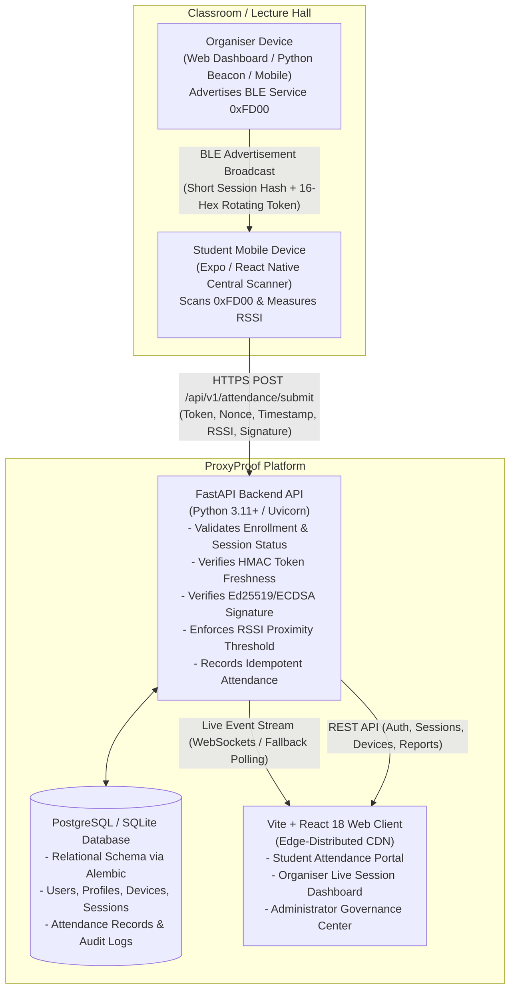
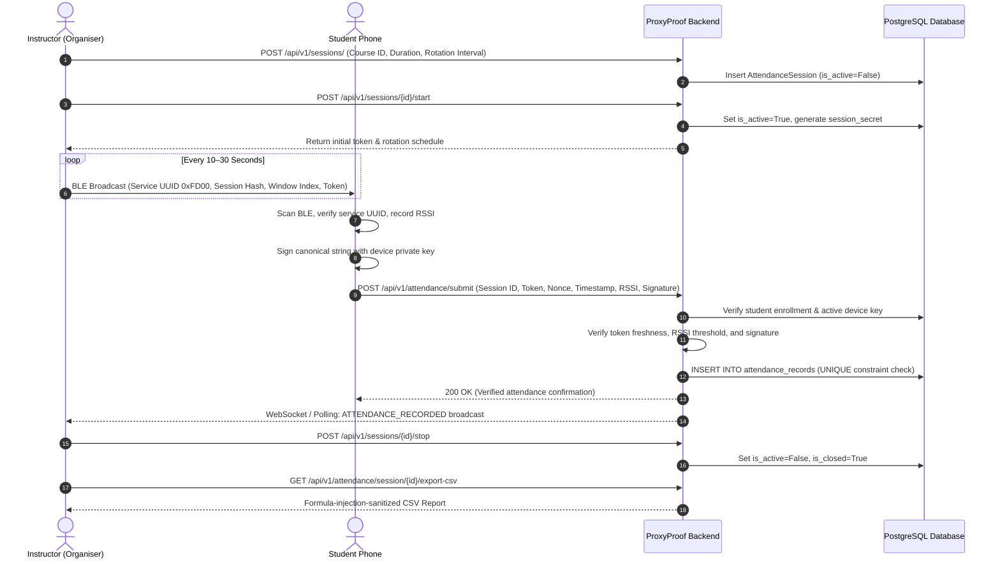

# 📡 ProxyProof

### Mobile-First Cryptographic Bluetooth Attendance & Multi-Factor Presence Verification System

[](https://proxyproof-neon.vercel.app)

[](https://www.python.org/)
[](https://fastapi.tiangolo.com/)
[](https://react.dev/)
[](https://www.typescriptlang.org/)
[](https://vitejs.dev/)
[](https://expo.dev/)
[](https://www.postgresql.org/)
[-success?logo=pytest&logoColor=white)](#automated-testing--verified-qa-results)
[](https://opensource.org/licenses/MIT)

---

<a id="executive-overview"></a>
## 📌 Executive Overview

**ProxyProof** is an attendance management and physical presence verification platform engineered to replace unreliable, easily manipulated attendance methods (such as paper sign-in sheets, static QR codes, or location pings).

Traditional attendance solutions suffer from pervasive "buddy-punching" and proxy check-ins:
* Static or projected QR codes are photographed and instantly forwarded over messaging apps to absent peers.
* GPS check-ins are easily spoofed using virtual location software or browser developer tools.
* Paper rosters invite forged signatures with zero audit trail.

ProxyProof addresses these vulnerabilities by synthesizing **Bluetooth Low Energy (BLE) proximity detection**, **high-frequency cryptographic token rotation**, and **device-bound asymmetric digital signatures**. Rather than relying on a single fallible signal, ProxyProof establishes multi-factor physical presence verification while operating reliably in high-density classroom and lecture hall environments.

> [!NOTE]
> **Real-World Security Posture:** ProxyProof substantially raises the barrier to fraud compared to traditional attendance methods. However, no automated software system can claim to be 100% immune to all physical-world relay attacks (such as custom radio frequency tunnels or a peer carrying another student's physical phone). ProxyProof combines cryptographic verification, proximity filtering, and instructor oversight to deliver practical, defense-in-depth presence assurance.

---

## 📑 Table of Contents

- [Executive Overview](#executive-overview)
- [Core Defense-in-Depth Mechanisms](#core-defense-in-depth-mechanisms)
- [System Architecture](#system-architecture)
- [User Workflows](#user-workflows)
  - [1. Student Workflow](#1-student-workflow)
  - [2. Organiser / Instructor Workflow](#2-organiser--instructor-workflow)
  - [3. Administrator Workflow](#3-administrator-workflow)
- [BLE Protocol & Cryptographic Specification](#ble-protocol--cryptographic-specification)
- [Repository Structure](#repository-structure)
- [Technology Stack](#technology-stack)
- [Local Installation & Setup](#local-installation--setup)
  - [Prerequisites](#prerequisites)
  - [1. Backend Setup (FastAPI)](#1-backend-setup-fastapi)
  - [2. Web Frontend Setup (React + Vite)](#2-web-frontend-setup-react--vite)
  - [3. Mobile Application Setup (Expo / React Native)](#3-mobile-application-setup-expo--react-native)
  - [4. Docker Compose Quickstart](#4-docker-compose-quickstart)
- [Environment Variables Configuration](#environment-variables-configuration)
- [Database Setup & Alembic Migrations](#database-setup--alembic-migrations)
- [Automated Testing & Verified QA Results](#automated-testing--verified-qa-results)
- [Security Measures, Threat Model & Real-World Realities](#security-measures-threat-model--real-world-realities)
  - [Hardened Application Controls](#hardened-application-controls)
  - [Physical World Realities & Known Limitations](#physical-world-realities--known-limitations)
- [Production Deployment Guidance](#production-deployment-guidance)
- [Development Seed Accounts](#development-seed-accounts)
- [Current Roadmap & Future Enhancements](#current-roadmap--future-enhancements)
- [License & Authors](#license--authors)

---

<a id="core-defense-in-depth-mechanisms"></a>
## 🛡️ Core Defense-in-Depth Mechanisms

ProxyProof implements multi-layered defensive controls to discourage fraudulent attendance:

```
┌────────────────────────────────────────────────────────────────────────────────────────┐
│                               LAYERED DEFENSE MODEL                                    │
├────────────────────────────┬───────────────────────────────────────────────────────────┤
│ 1. Ephemeral Rotating Tokens│ HMAC-SHA256 tokens rotate every 10–30s. Forwarded photos   │
│                            │ or shared strings expire before an absent peer can use them│
├────────────────────────────┼───────────────────────────────────────────────────────────┤
│ 2. Hardware Asymmetric Key │ Claims are digitally signed using Ed25519/ECDSA private   │
│    Pair Binding            │ keys bound to the physical device. Private keys never leave│
├────────────────────────────┼───────────────────────────────────────────────────────────┤
│ 3. 1-to-1 Device Policy    │ Each student account can bind to exactly one active phone. │
│    & Admin Approval        │ Device replacements require formal administrative review.  │
├────────────────────────────┼───────────────────────────────────────────────────────────┤
│ 4. Proximity RSSI Guard    │ Received Signal Strength Indicator (RSSI) must meet the   │
│                            │ session threshold (e.g. >= -80 dBm) to filter distant logs│
├────────────────────────────┼───────────────────────────────────────────────────────────┤
│ 5. Strict Idempotency &    │ Server enforces UNIQUE(session_id, student_profile_id) and│
│    Anti-Replay Nonces      │ single-use nonces to defeat replay attacks and race conds.│
├────────────────────────────┼───────────────────────────────────────────────────────────┤
│ 6. Real-Time Dashboard     │ Organisers monitor live check-ins via WebSockets / polling│
│    & Immutable Audit Trail │ with mandatory logged reasons for manual status overrides. │
└────────────────────────────┴───────────────────────────────────────────────────────────┘
```

1. **Short-Lived Rotating Cryptographic Tokens:**  
   During an active session, the organiser's device broadcasts short-lived tokens derived from a session secret and a time window index (`floor(timestamp / rotation_interval)`). Because tokens rotate frequently (default: every 10–30 seconds), photographing or copying a code to an absent classmate fails.
2. **Device-Bound Asymmetric Cryptography:**  
   When a student registers their physical device, an asymmetric keypair (Ed25519 or NIST P-256) is generated and bound to their profile. Attendance submissions require a digital signature over a canonical payload `(student_id, session_id, token, timestamp, nonce, rssi)`. The server verifies this against the student's registered public key.
3. **Strict Single-Device Policy & Admin Review:**  
   A student account can possess only one active registered device at any time. If a student replaces their phone, they must submit a formal replacement request stating the reason; an administrator must approve the change before the new device can submit attendance claims.
4. **Proximity & Signal Strength (RSSI) Filtering:**  
   Student devices measure the Received Signal Strength Indicator (RSSI) of the beacon broadcast. The backend enforces a minimum RSSI threshold (default: $\ge -80\text{ dBm}$ to $-85\text{ dBm}$) to filter out check-ins from hallways or neighboring rooms.
5. **Database-Level Idempotency & Nonce Verification:**  
   The attendance database table enforces a database-level composite unique constraint on `(session_id, student_profile_id)`. Simultaneous duplicate submissions are rejected with `409 Conflict`. Unique nonces and freshness windows prevent replay attacks.
6. **Real-Time Organiser Oversight & Transparent Audit Logging:**  
   Instructors watch verified check-ins arrive live on their dashboard. If an edge case requires manual correction, the instructor must specify a structured reason, which is permanently recorded in the immutable administrative audit log.

---

<a id="system-architecture"></a>
## 🏗️ System Architecture



### Component Responsibilities

| Component | Technology | Primary Responsibilities |
|---|---|---|
| **Web Frontend** | React 18, TypeScript, Vite, Tailwind CSS, Lucide | Responsive portal for students (history, percentages, device status), instructors (session controls, live attendance monitor, CSV exports), and administrators (user management, device change reviews, audit logs). |
| **Backend API** | FastAPI, Python 3.11+, SQLAlchemy 2.0, Pydantic v2 | High-performance async ASGI application handling authentication, RBAC authorization, cryptographic verification, attendance validation, rate limiting, and live WebSocket broadcasts. |
| **Mobile App** | React Native, Expo SDK 51, TypeScript | Physical hardware client that requests Bluetooth permissions, scans for the ProxyProof `0xFD00` service, measures RSSI, digitally signs attendance claims using local cryptographic keys, and submits payloads. |
| **Database** | PostgreSQL 15+ (Production) / SQLite (Dev/Test) | Relational database managed with Alembic migrations. Enforces foreign key constraints, composite unique indexes, and audit logs. |

---

<a id="user-workflows"></a>
## 🔄 User Workflows



### 1. Student Workflow
1. **Authentication & Profile:** Log in with institutional credentials; view enrolled courses and aggregate attendance percentages.
2. **Device Registration:** Register the physical smartphone keypair. The system stores the public key and activates the device.
3. **Device Replacement Requests:** If a student acquires a new phone, they submit a formal change request with an explanatory note; pending requests remain visible until administrator review.
4. **Attendance Check-In:** Launch the mobile app or supported scanning client, ensure Bluetooth is enabled, and allow automatic discovery of the active session beacon. The device signs the claim and displays immediate confirmation upon server verification.
5. **History & Percentages:** View session-by-session attendance records (`PRESENT`, `ABSENT`, or `EXCUSED`) with transparent calculations.

### 2. Organiser / Instructor Workflow
1. **Session Management:** Select an enrolled course, configure duration, RSSI threshold, and token rotation interval, then start the session.
2. **Beacon Broadcasting:** Broadcast the `0xFD00` service payload via physical mobile broadcaster or the provided companion beacon script (`scripts/ble_organiser_beacon.py`).
3. **Live Attendance Monitoring:** View check-ins in real time over WebSockets (with automatic 5-second polling fallback in environments without persistent socket support).
4. **Authorised Manual Overrides:** Correct attendance statuses (e.g. excused absences) by providing a mandatory explanation, permanently logged in the audit trail.
5. **Sanitized CSV Export:** Export session reports with protection against formula injection attacks (`=`, `+`, `-`, `@` cell prefix sanitization).

### 3. Administrator Workflow
1. **User & Role Governance:** Inspect user profiles, activate/deactivate accounts, and adjust role assignments (`STUDENT`, `ORGANISER`, `ADMIN`).
2. **Device Change Reviews:** Review pending device replacement requests; inspect student details, reason, and replacement timestamp; approve or reject requests with administrative notes.
3. **Direct Device Revocation:** Revoke lost, compromised, or decommissioned devices directly.
4. **Forensic Attendance Investigation:** Filter attendance records across courses, sessions, students, and statuses with comprehensive forensic queries.
5. **System Audit Logs:** Review the immutable chronological audit trail tracking all administrative actions and manual overrides.

---

<a id="ble-protocol--cryptographic-specification"></a>
## 📡 BLE Protocol & Cryptographic Specification

ProxyProof uses Bluetooth Low Energy (BLE) advertising packets formatted to comply with the standard 31-byte Bluetooth advertising frame limit:

```
┌────────────────────────────────────────────────────────────────────────┐
│               PROXYPROOF BLE ADVERTISEMENT PACKET (21 BYTES)           │
├──────────────┬──────────────────┬─────────────────┬────────────────────┤
│ Version (1B) │ Session Hash (8B)│ Window Index (4B│ Rotating Token (8B)│
│    0x01      │ SHA-256 Truncated│ Big-Endian int  │ HMAC-SHA256 Trunc. │
└──────────────┴──────────────────┴─────────────────┴────────────────────┘
```

* **Service UUID:** `0000FD00-0000-1000-8000-00805F9B34FB` (16-bit short ID `0xFD00`).
* **Rotating Window Index:** Calculated as `floor(current_unix_timestamp / rotation_interval_seconds)`.
* **Token Derivation:**
  $$\text{Token} = \text{HMAC-SHA256}(\text{session\_secret}, \text{session\_id} \parallel \text{window\_index})[0..7]$$
* **Canonical Check-in Signature Payload:**
  ```
  "{student_id}:{session_id}:{token}:{timestamp}:{nonce}:{rssi}"
  ```
* **Supported Asymmetric Signature Algorithms:**
  * **Ed25519 (RFC 8032):** High-speed Edwards-curve digital signatures (recommended).
  * **ECDSA (NIST P-256 / SECP256R1):** Standard WebCrypto/FIPS compliant curve using SPKI PEM formatting.

---

<a id="repository-structure"></a>
## 📂 Repository Structure

```
ProxyProof-VV/
├── api/                           # Vercel serverless entrypoint wrapper (delegates to backend/app)
│   └── index.py
├── backend/                       # FastAPI Production Backend Application
│   ├── alembic/                   # Database schema migrations
│   │   ├── env.py
│   │   └── versions/              # Migration revision scripts
│   ├── alembic.ini                # Alembic migration configuration
│   ├── api/                       # Standalone backend Vercel serverless entrypoint
│   │   └── index.py
│   ├── app/
│   │   ├── api/                   # Modular REST endpoints (v1)
│   │   │   ├── admin.py           # User management, audit logs, forensic search
│   │   │   ├── attendance.py      # Check-in validation, overrides, CSV export
│   │   │   ├── auth.py            # Registration, login, profile management
│   │   │   ├── courses.py         # Course creation and student enrollment
│   │   │   ├── devices.py         # Hardware registration and change requests
│   │   │   └── sessions.py        # Attendance session lifecycle & token polling
│   │   ├── core/                  # Security, crypto, rate limiting, and WebSockets
│   │   │   ├── crypto.py          # Ed25519 & ECDSA verification, HMAC token logic
│   │   │   ├── rate_limit.py      # Sliding-window IP rate limiter
│   │   │   ├── security.py        # Bcrypt password hashing & JWT authentication
│   │   │   └── websocket.py       # Live attendance broadcast manager
│   │   ├── database.py            # SQLAlchemy engine, session factory, Base
│   │   ├── config.py              # Pydantic Settings with production validation
│   │   ├── main.py                # FastAPI app initialization, middleware, routes
│   │   ├── models/                # SQLAlchemy ORM declarative models
│   │   ├── schemas/               # Pydantic v2 validation models
│   │   └── tests/                 # Comprehensive automated test suite (56 tests)
│   ├── Dockerfile                 # Backend container definition
│   ├── requirements.txt           # Python dependencies (FastAPI, SQLAlchemy, etc.)
│   ├── run.py                     # Local Uvicorn server launcher
│   └── vercel.json                # Standalone backend Vercel deployment configuration
├── frontend/                      # React 18 + Vite SPA Frontend
│   ├── src/
│   │   ├── api/                   # Typed API client with auto-fallback polling
│   │   ├── components/            # Reusable UI components & layouts
│   │   ├── context/               # Authentication & session React contexts
│   │   ├── pages/                 # Role-based views (Student, Organiser, Admin)
│   │   └── types/                 # TypeScript interface definitions
│   ├── package.json               # Frontend dependencies & build scripts
│   ├── tsconfig.json              # TypeScript configuration
│   ├── vercel.json                # Frontend Vercel Edge configuration
│   └── vite.config.ts             # Vite build & bundler configuration
├── mobile/                        # React Native / Expo Native Mobile Client
│   ├── src/                       # Central BLE scanning, crypto, and API services
│   ├── App.tsx                    # Mobile application root component
│   └── package.json               # Expo & React Native dependencies
├── docs/                          # In-depth architectural & audit documentation
│   ├── ACCEPTANCE_CRITERIA.md     # Verified functional acceptance matrix
│   ├── API.md                     # REST API endpoint reference
│   ├── BLE_PROTOCOL.md            # Byte-level BLE advertising & scanning spec
│   ├── BLE_IMPLEMENTATION.md      # Mobile & peripheral implementation details
│   ├── DEPLOYMENT_GUIDE.md        # Comprehensive multi-target deployment guide
│   ├── FINAL_ACCEPTANCE_REPORT.md # Independent release audit report
│   ├── QA_REPORT.md               # Automated testing & test coverage report
│   └── SECURITY_AUDIT.md          # Threat model, audit findings & remediation
├── scripts/                       # Operational & companion developer utilities
│   └── ble_organiser_beacon.py    # Python BLE advertiser for testing
├── .env.example                   # Master environment variable reference template
├── docker-compose.yml             # Local multi-container Docker Compose configuration
├── package.json                   # Root monorepo script coordinator
├── requirements.txt               # Root serverless dependency declaration
└── vercel.json                    # Root full-stack Vercel deployment configuration
```

---

<a id="technology-stack"></a>
## 💻 Technology Stack

* **Backend Framework:** FastAPI 0.110+ on Python 3.11 / 3.13
* **Web Server & ASGI:** Uvicorn 0.28+ with native WebSocket support
* **Database & ORM:** PostgreSQL 15+ (Production) / SQLite (Local Test), SQLAlchemy 2.0.28+, Alembic 1.13+
* **Validation & Settings:** Pydantic v2.6+ and Pydantic-Settings
* **Cryptography:** Python `cryptography` 42.0+ (Ed25519, NIST P-256 SPKI/SEC1), `python-jose` (JWT), `passlib` with `bcrypt`
* **Web Frontend:** React 18, TypeScript 5.5, Vite 5.4, Tailwind CSS, Lucide React
* **Mobile Client:** React Native 0.74, Expo SDK 51, TypeScript
* **Testing:** Pytest 9.1+, Pytest-Asyncio, HTTPX
* **Deployment & Containers:** Vercel (Edge CDN & Serverless Python Functions), Docker, Docker Compose

---

<a id="local-installation--setup"></a>
## 🚀 Local Installation & Setup

### Prerequisites
* **Python:** 3.11 or newer (Python 3.13 supported)
* **Node.js:** v18.0.0 or newer (v20+ LTS recommended)
* **Package Managers:** `pip` and `npm`
* **Git:** Installed and configured

### 1. Backend Setup (FastAPI)

```bash
# 1. Clone the repository
git clone https://github.com/SarveshS1407/ProxyProof-VV.git
cd ProxyProof-VV

# 2. Create and activate a Python virtual environment
python3 -m venv .venv
source .venv/bin/activate  # On Windows: .venv\Scripts\activate

# 3. Install backend dependencies
pip install -r backend/requirements.txt

# 4. Apply database migrations
cd backend
alembic upgrade head

# 5. Launch the backend server
python run.py
```
* **API Server:** [http://localhost:8000](http://localhost:8000)
* **Interactive Swagger Documentation:** [http://localhost:8000/docs](http://localhost:8000/docs)
* **Health Check Endpoint:** [http://localhost:8000/health](http://localhost:8000/health)

### 2. Web Frontend Setup (React + Vite)

In a separate terminal window:
```bash
# 1. Navigate to the frontend directory
cd frontend

# 2. Install Node dependencies
npm install

# 3. Start the Vite development server
npm run dev
```
* **Web Application:** [http://localhost:5174](http://localhost:5174) (default port `5174` configured in `vite.config.ts`)

### 3. Mobile Application Setup (Expo / React Native)

In a separate terminal window:
```bash
# 1. Navigate to the mobile directory
cd mobile

# 2. Install dependencies
npm install

# 3. Launch Expo development server
npx expo start
```
* Press `a` to run on an attached Android device / emulator, or scan the QR code using the Expo Go application on physical hardware.

### 4. Docker Compose Quickstart

To run the complete stack (Backend + Frontend) in isolated containers:
```bash
docker-compose up -d --build
```
* Backend API available at [http://localhost:8000](http://localhost:8000)
* Web Frontend available at [http://localhost:5173](http://localhost:5173)

---

<a id="environment-variables-configuration"></a>
## ⚙️ Environment Variables Configuration

Copy [.env.example](file:///.env.example) to `.env` to configure application parameters:

| Variable | Required | Default / Example | Purpose / Description |
|---|:---:|---|---|
| `PROJECT_NAME` | No | `ProxyProof` | Display title for the platform. |
| `ENVIRONMENT` | **Yes** | `production` / `development` | Runtime environment mode. In `production`, debug leaks and demo accounts are blocked. |
| `DEBUG` | **Yes** | `false` | Must be `false` in production to prevent traceback leaks. |
| `SECRET_KEY` | **Yes** | *(32+ char hex key)* | Cryptographic key used to sign JWT access tokens. Generate with `openssl rand -hex 32`. |
| `DATABASE_URL` | **Yes** | `postgresql://...` | Connection string. Must use `postgresql://` and include `sslmode=require` in production. |
| `CORS_ORIGINS` | **Yes** | `https://proxyproof.vercel.app,...` | Comma-separated list of allowed origins. |
| `BLE_SERVICE_UUID` | No | `0000FD00-0000-1000-8000-00805F9B34FB` | Standard 16-bit short ID `0xFD00` ProxyProof BLE Service UUID. |
| `BLE_TOKEN_ROTATION_SECONDS` | No | `10` | Rotating token lifetime in seconds. |
| `DEFAULT_MIN_RSSI` | No | `-85` | Signal attenuation threshold in dBm for physical proximity. |
| `RATE_LIMIT_ENABLED` | No | `true` | Enables sliding-window rate limiting on login and submission routes. |
| `SEED_DEMO_DATA` | No | `false` | Must be `false` in production. Controls automatic demo account seeding. |
| `AUTO_CREATE_TABLES` | No | `false` | Must be `false` in production. Schema is strictly managed via Alembic. |
| `VITE_API_URL` | Optional | `https://<backend>.vercel.app` | Frontend API URL. If empty, client uses relative `/api/v1`. |

---

<a id="database-setup--alembic-migrations"></a>
## 🗄️ Database Setup & Alembic Migrations

ProxyProof uses Alembic for declarative, version-controlled schema migrations:

```bash
# Activate environment and enter backend
source .venv/bin/activate
cd backend

# View current migration revision
alembic current

# Apply all pending schema migrations
alembic upgrade head

# Roll back the most recent migration (if needed)
alembic downgrade -1
```

All 9 application tables (`users`, `student_profiles`, `devices`, `device_change_requests`, `courses`, `course_enrollments`, `attendance_sessions`, `attendance_records`, and `audit_logs`) are created with relational constraints and composite unique indexes to guarantee data integrity.

---

<a id="automated-testing--verified-qa-results"></a>
## 🧪 Automated Testing & Verified QA Results

ProxyProof includes a comprehensive automated test suite executed with `pytest` covering end-to-end business workflows, authentication, role isolation, cryptographic signature validation, token expiry, and security hardening.

### Executing the Test Suite
```bash
source .venv/bin/activate
cd backend
PYTHONPATH=. pytest -v
```

### Verified Test Run Results: **56 Passed, 100% Pass Rate**

```
============================= test session starts ==============================
platform darwin -- Python 3.13.5, pytest-9.1.1, pluggy-1.7.0
rootdir: /Users/kingpin/Documents/Vinno-2/backend

app/tests/test_admin.py ........                                         [ 14%]
app/tests/test_attendance.py ......                                      [ 25%]
app/tests/test_auth.py ...........                                       [ 44%]
app/tests/test_ble_protocol.py ....                                      [ 51%]
app/tests/test_crypto.py .....                                           [ 60%]
app/tests/test_device.py ....                                            [ 67%]
app/tests/test_production_security.py .........                          [ 83%]
app/tests/test_reports.py ..                                             [ 87%]
app/tests/test_security_hardening.py .......                             [100%]

======================== 56 passed, 1 warning in 16.28s ========================
```

| Test Module | Tests | Verified Functional Scope |
|---|:---:|---|
| `test_admin.py` | 8 | Platform analytics, audit log inspection, user role updates, direct device revocation, and forensic search. |
| `test_attendance.py` | 6 | Check-in verification, duplicate prevention (`409 Conflict`), weak signal rejection, expired token rejection, cross-organiser session ownership isolation (`403 Forbidden`), manual overrides, and sanitized CSV generation. |
| `test_auth.py` | 11 | Registration, duplicate email rejection, Bcrypt password hashing, JWT token generation, profile updates, and password change with current password verification. |
| `test_ble_protocol.py` | 4 | Packet serialization and deserialization within 31-byte frame, clock skew tolerance ($\pm 1$ window), and full advertisement decoding. |
| `test_crypto.py` | 5 | Asymmetric keypair generation, signature verification (Ed25519 & ECDSA P-256), payload tampering detection, and public key format validation. |
| `test_device.py` | 4 | Single-device binding, public key validation, duplicate device rejection, and device replacement approval workflow. |
| `test_production_security.py` | 9 | Strict production secret enforcement, `DEBUG=False` validation, database health verification (`/health`), opt-in demo seeding, and WebSocket authentication & RBAC authorization. |
| `test_reports.py` | 2 | Attendance percentages, excused session handling, and division-by-zero safety. |
| `test_security_hardening.py` | 7 | Security headers (`nosniff`, `DENY`, `strict-origin`), sliding-window login rate limiting, cross-role escalation defense, nonce replay prevention, and CSV formula injection defense. |

---

<a id="security-measures-threat-model--real-world-realities"></a>
## 🔒 Security Measures, Threat Model & Real-World Realities

### Hardened Security Controls
* **Cryptographic Signatures:** Every check-in claim is signed with the student's hardware private key, preventing spoofed submissions without access to the student's physical device.
* **Anti-Replay Protection:** Nonce verification and short-lived timestamp checks ensure each signed claim is valid only once.
* **Strict Role-Based Access Control (RBAC):** Students cannot view other students' records; instructors cannot modify sessions they do not own; administrative operations require verified `ADMIN` role tokens.
* **CSV Injection Defense:** Spreadsheet exports automatically prepend a tab character to dangerous formula prefixes (`=`, `+`, `-`, `@`), preventing CSV formula execution in Excel or Google Sheets.
* **Sliding-Window Rate Limiting:** In-memory sliding-window limiter defends authentication and submission endpoints against credential-stuffing and brute-force attacks.
* **Security Headers Middleware:** Responses enforce `X-Content-Type-Options: nosniff`, `X-Frame-Options: DENY`, `X-XSS-Protection: 1; mode=block`, and `Referrer-Policy: strict-origin-when-cross-origin`.

### Physical World Realities & Known Limitations
* **RF Relay / Wormhole Attacks:** An adversary with specialized, ultra-low-latency directional radio transceivers could theoretically relay a BLE advertisement across campus in real time. *Mitigations: Short token rotation windows (10–30s), RSSI proximity thresholding, and instructor visual dashboard monitoring.*
* **Physical Device Transfer:** If a student physically hands their unlocked smartphone to an attendee, software cannot detect that the owner is not holding their own device. *Mitigations: Requiring device biometrics/passcode on check-in, periodic randomized manual roll calls, and academic integrity policies.*
* **Environmental Signal Attenuation:** Bluetooth signal strength fluctuates depending on walls, obstacles, room occupancy, and human body shielding. The RSSI threshold serves as an approximate distance filter ($\ge -80\text{ dBm}$ to $-85\text{ dBm}$) rather than a centimeter-precision radar.

---

<a id="production-deployment-guidance"></a>
## 🌐 Production Deployment Guidance

ProxyProof is designed for seamless deployment on cloud infrastructure:

### Vercel Deployment Architecture
ProxyProof supports two Vercel deployment models, detailed in [`docs/DEPLOYMENT_GUIDE.md`](docs/DEPLOYMENT_GUIDE.md):

1. **Decoupled Architecture (Recommended):**
   * **Frontend Project:** Import `frontend` directory as a **Vite** project on Vercel. Deploys to Vercel's global Edge CDN. Set `VITE_API_URL` to your backend domain.
   * **Backend Project:** Import `backend` directory as a **FastAPI** project on Vercel (or host on Render/Railway/Fly.io if persistent full-duplex WebSockets are required). Handled via [backend/vercel.json](file:///backend/vercel.json) and [backend/api/index.py](file:///backend/api/index.py).
2. **Single Unified Project:**
   * Import root directory `./` (detected as `app` by Vercel).
   * **Crucial Setting:** Change Framework Preset from `FastAPI` to **`Other`** so that Vercel executes the Vite frontend build command (`npm run build`) and serves `frontend/dist`.

---

<a id="development-seed-accounts"></a>
## 👥 Development Seed Accounts

In local development (`ENVIRONMENT="development"` and `SEED_DEMO_DATA=True`), the database automatically seeds verified test accounts:

| Role | Email | Password | Pre-Configured Test Persona |
|:---|:---|:---|:---|
| **Student** | `student@university.edu` | `StudentPass123!` | Alice Smith (Roll: `CS-2024-001`, Enrolled in `CS301`, Active Verified Device) |
| **Organiser** | `prof@university.edu` | `ProfPass123!` | Prof. Alan Turing (Instructor for `CS301: Distributed Systems`) |
| **Administrator** | `admin@proxyproof.edu` | `AdminPass123!` | System Administrator (Full device change approval & audit rights) |

> [!CAUTION]
> In production (`ENVIRONMENT="production"`), demo accounts are **strictly disabled** unless explicitly enabled via environment configuration. Fresh production databases should be seeded with an initial administrator using `INITIAL_ADMIN_EMAIL` and `INITIAL_ADMIN_PASSWORD`.

---

<a id="current-roadmap--future-enhancements"></a>
## 🗺️ Current Roadmap & Future Enhancements

- [x] Complete REST API with JWT authentication and RBAC
- [x] Ephemeral HMAC-SHA256 rotating token generator
- [x] Asymmetric Ed25519 and ECDSA digital signature verification
- [x] Real-time instructor dashboard with WebSocket streaming and fallback polling
- [x] Single-device policy with administrative approval workflows
- [x] Formula-injection-sanitized CSV export
- [x] Comprehensive 56-test automated verification suite
- [x] Standalone and unified Vercel deployment configurations
- [ ] Native biometric prompt integration on mobile claim submission (FaceID / Fingerprint)
- [ ] Multi-point RSSI triangulation using distributed classroom listener nodes
- [ ] Push notifications for device replacement review decisions

---

<a id="license--authors"></a>
## 📄 License & Authors

This project is licensed under the **MIT License** — see the [LICENSE](LICENSE) file for details.

Developed for institutions seeking dependable, transparent, and auditable attendance verification.
